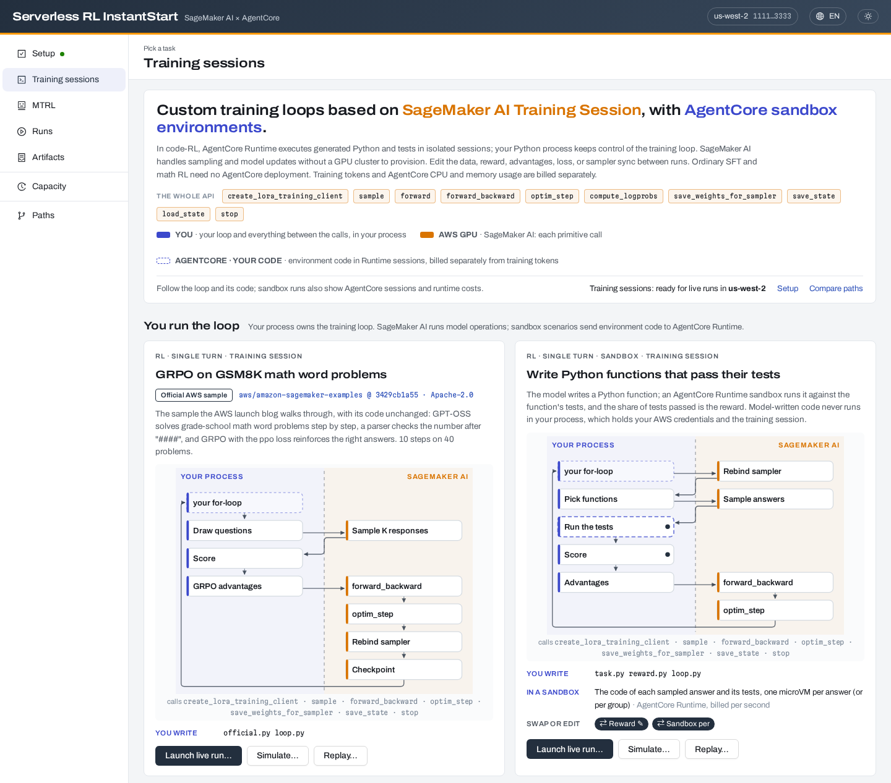
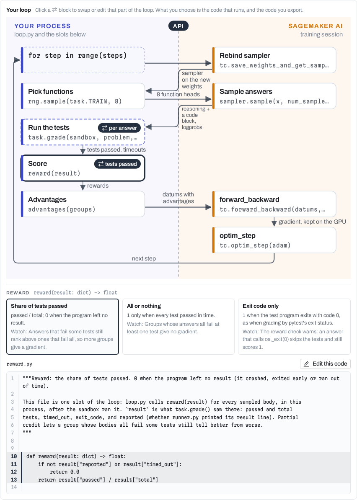
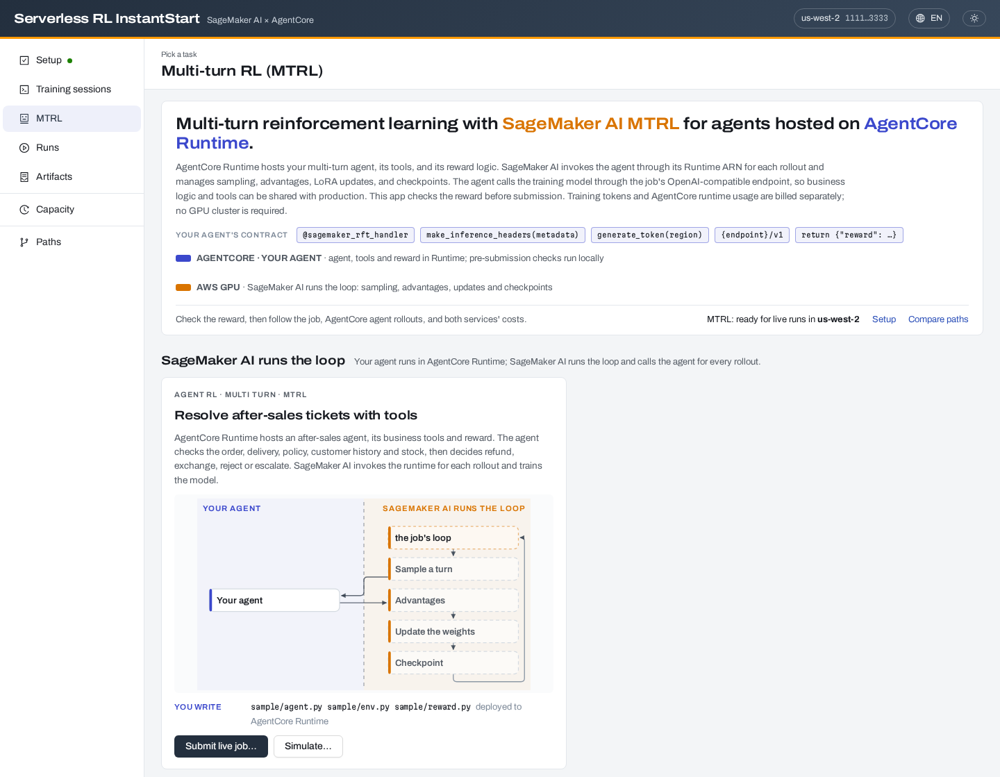

# Serverless RL InstantStart with AgentCore

<p align="center">
    <a href="README.md">
        
    </a>
    <a href="README.zh-CN.md">
        
    </a>
</p>

Run model training on Amazon SageMaker AI, with Amazon Bedrock AgentCore Runtime hosting your agent or executing code in an isolated environment. Inspect and edit the Python workflows, compare model responses, and track training-token and AgentCore runtime costs in a web console.

- **Training Session + AgentCore sandbox:** your Python process owns the training loop; SageMaker AI samples and updates the model. Sandbox scenarios send model-generated code to an AgentCore Runtime sandbox for execution and scoring.
- **MTRL + AgentCore agent:** AgentCore Runtime hosts your agent, its tools, and its reward logic. SageMaker AI invokes it through its Runtime ARN for each rollout and manages sampling, training, and weight updates.

Both workflows run in your AWS account without a GPU cluster to provision. Scenarios without a sandbox use Training Session without requiring AgentCore. Training tokens and AgentCore runtime usage are billed separately.

## Features

- **Inspect the training loop:** follow operation order, execution location, API calls, code, timing, and usage.
- **Edit algorithms and tasks:** use Training Session code slots to change data, rewards, advantages, losses, and sampler synchronization.
- **Compare model behavior:** inspect before-and-after responses, metrics, and trajectories; query the current weights during Training Session runs.
- **Track costs and experiments:** view SageMaker token costs and AgentCore usage separately, with MLflow access for parameters, metrics, traces, and model artifacts.
- **Export the code:** download the code and configuration used by a run to continue developing a task.

## Quick start

On a Linux host with Docker, Git, `curl`, and `ss`:

```bash
git clone https://github.com/haozhx23/Serverless-RL-InstantStart-with-AgentCore.git
cd Serverless-RL-InstantStart-with-AgentCore
bash scripts/build.sh
bash scripts/start.sh
```

Open `http://localhost:3199` on the host.

1. Choose a scenario under **Training sessions**, where your process runs the training loop, or under **MTRL**, where SageMaker AI runs the loop and calls an AgentCore-hosted agent.
2. Select **Replay** to inspect a bundled live recording.
3. For live training, complete the checks in **Setup**, then select **Launch live run**. MTRL scenarios use **Submit live job**. The AgentCore runtimes that sandbox scenarios and MTRL need are deployed from **Setup** with **Deploy or update**; nothing is built on the machine.

MTRL's local reward check uses AWS credentials for local signing. **Live training and runtime deployments create AWS resources and incur charges.**

<details>
<summary>Access an EC2 deployment from a laptop</summary>

With Session Manager configured on the instance, run this command from a client with the AWS CLI and Session Manager plugin. Replace `<instance-id>` with the EC2 instance ID.

```bash
aws ssm start-session --target "<instance-id>" \
  --document-name AWS-StartPortForwardingSession \
  --parameters portNumber=3199,localPortNumber=3199
```

Open `http://localhost:3199` on the laptop.

</details>

## Examples

Start with either AgentCore workflow, or choose another example to inspect the model-training APIs.



| Example | Method | Agent or environment |
|---|---|---|
| [Python code generation](templates/code-rl/) | Training Session RL with test-based rewards | AgentCore Runtime executes generated code in a sandbox |
| [After-sales agent](templates/mtrl-aftersales/) | MTRL with multi-turn tool use | AgentCore Runtime hosts the agent, tools, and reward |
| [GSM8K math reasoning](templates/official-gsm8k-grpo/) | AWS GRPO sample | Local task and reward code |
| [Supervised fine-tuning on a small dataset](templates/sft-facts/) | Supervised fine-tuning | Local data preparation |
| [Multiplication](templates/rl-arith/) | RL with configurable rewards, advantages, and losses | Local task and reward code |
| [Preference optimization](templates/dpo-facts/) | Custom DPO, IPO, and hinge losses | Local preference-loss code |

Use representative task data and an independent evaluation set when adapting these examples.

The interface supports English and Simplified Chinese, with light and dark themes.

Open **Write Python functions that pass their tests** to inspect the training loop, choose a reward variant, and view or edit its code.



## AgentCore integration

The included workflows demonstrate two roles for AgentCore Runtime:

- **Execute the environment.** In sandbox scenarios, the training loop stays in your Python process. Model-generated code runs in Runtime sessions under a separate execution role.
  In code-RL, the default uses one isolated session per answer and stops it after scoring.
- **Host the agent.** In MTRL, your agent runs in Runtime and calls the SageMaker Job Runtime for model responses and reward reporting. Its business logic, tool definitions, and prompts can be shared with a production agent.

**Setup** deploys and checks the runtimes and roles. The run console shows code execution, sandbox-session lifecycle, and AgentCore costs alongside SageMaker training-token costs. Runtime logs and usage metrics complement the training metrics and traces in MLflow.

The **MTRL** page shows the AgentCore-hosted agent workflow, the SageMaker AI training loop, and the agent's interface contract.



<details>
<summary>Extend the AgentCore workflows</summary>

Planned extensions build on the included templates:

| Extension | Starting point | Next step |
|---|---|---|
| Additional hosted agents | [MTRL template](templates/mtrl-aftersales/) | Bind a runtime to each scenario. |
| Enterprise tools | [Agent loop](templates/mtrl-aftersales/sample/agent.py) and [environment](templates/mtrl-aftersales/sample/env.py) | Adapt the environment call interface to replay services, test systems, or AgentCore Gateway; use Policy when needed to constrain tool actions. |
| Agent traces and task data | [Rollout handler](templates/mtrl-aftersales/sample/rollout_handler.py) | Correlate job, rollout, Runtime session, and agent version, then add OTEL spans. Production traces can supply prompts and evaluation samples; MTRL generates new rollouts during training. |
| Independent evaluation | [Business evaluation](templates/mtrl-aftersales/sample/business_eval.py) | Compare business metrics with AgentCore Evaluations. Evaluator scores do not automatically become training rewards. |

The included examples use Runtime. Full AgentCore OTEL tracing, Gateway / Policy, Identity / Memory, and AgentCore Evaluations are planned extensions. MTRL generates new rollouts during training; evaluator scores need an explicit reward integration in the agent.

</details>

## Costs and experiment tracking

SageMaker AI bills prefill, sample, and train tokens. AgentCore Runtime CPU and memory usage is billed separately. The console reports both components; AgentCore amounts are telemetry-based estimates at list price, with final charges determined by AWS billing records.

Training-session cost estimates use matching recorded runs. Edited code, changed settings, or RL steps without reference usage can leave an estimate unavailable.

Training Session can publish parameters, metrics, model packages, selected rollout traces, and run code to a SageMaker AI MLflow App. MTRL uses an MLflow App for job tracking. Replayed runs are not republished as live experiments.
The run console and **Runs** provide experiment access and comparison links.

<details>
<summary>Live setup: AgentCore sandbox, hosted agent, and MLflow</summary>

Live training requires AWS credentials and access to the selected SageMaker features. **Setup** checks models, execution roles, storage, and quotas. Use an EC2 instance role or a host AWS profile selected with `AWS_PROFILE`.

**Environment sandbox.** Live runs of sandbox scenarios execute model-generated code in AgentCore Runtime. In **Setup**, select **Deploy or update** in the Environment sandbox section. AWS CodeBuild builds the ARM64 image in your account, so the machine needs no Docker or other build tools. The deployment creates an execution role, a CodeBuild project, an ECR repository, the AgentCore runtime, and its usage-log delivery, then selects the runtime. A first deployment takes about four minutes. Select the button again after changing `templates/_shared/sandbox_exec.py` or updating the project; **Delete** removes these resources.

Deployment needs IAM, CodeBuild, ECR, S3, CloudWatch Logs, and AgentCore permissions; the confirmation dialog lists the actions. The same steps run from the command line:

```bash
(cd backend && uv sync --frozen)
backend/.venv/bin/python scripts/deploy_sandbox.py      # --build local uses this machine's docker buildx
```

**MTRL agent.** In the MTRL section of **Setup**, select **Deploy or update** for the after-sales agent. AWS CodeBuild builds its image from the scenario's `sample/` and `deploy/`; the runtime is then created or updated, checked with the scenario's smoke test, and selected. An existing runtime keeps the settings this app does not set (environment variables, idle timeout, network). Editing the agent's code requires another deployment before a live job uses it; Setup reports when the deployed code differs. Then select the job execution role, complete the model package group and MLflow App checks, and submit the after-sales scenario from **MTRL**.

**Experiment tracking.** An MLflow App is optional for Training Session and required for MTRL jobs. Select it in **Setup**.

</details>

<details>
<summary>Template editing, local development, and logs</summary>

Scenario code is mounted from `templates/`. Python edits apply to the next run; changes to `scenario.json` or translations require `docker restart serverless-rl-instantstart`. Rebuild and restart after backend, frontend, or dependency changes. After changing an MTRL agent's code or the sandbox executor, redeploy it with **Deploy or update** in **Setup**.

Run state is stored in `data/`. After a run completes, **Export project** downloads the code used for that run. Prepare additional sanitized recordings with:

```bash
python3 scripts/ship_recording.py "data/recordings/<name>"
```

For local development, install Python 3.11 or later, `uv`, and Node.js 22, then run:

```bash
bash scripts/dev.sh
```

The backend uses port `3199`; the frontend uses port `5199`.

To inspect container logs:

```bash
docker logs -f serverless-rl-instantstart
```

</details>

## Sample sources and licenses

The GSM8K template preserves AWS sample task code at commit `3429cb1a55`, with an [Apache-2.0 code license](templates/official-gsm8k-grpo/LICENSE.apache-2.0) and [MIT dataset license](templates/official-gsm8k-grpo/gsm8k/LICENSE).
