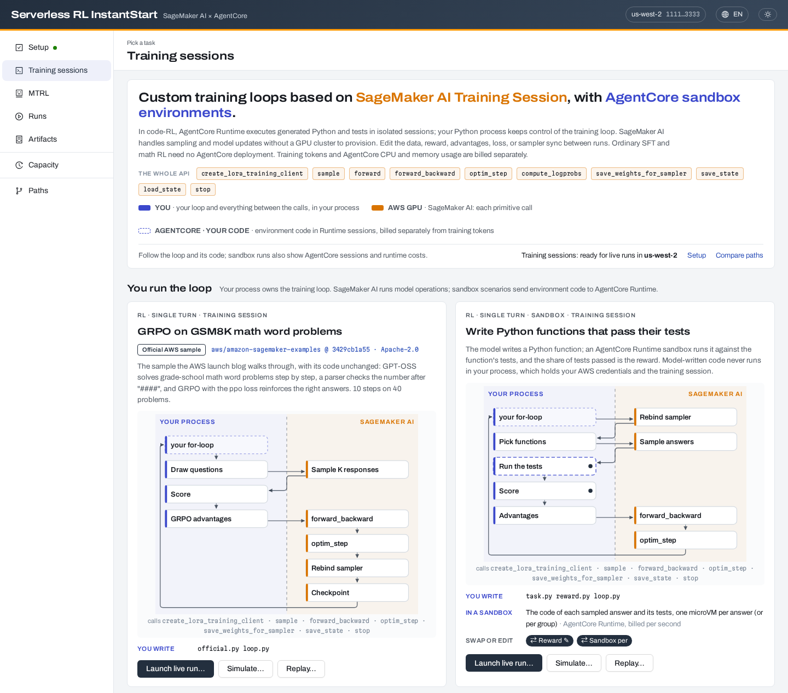
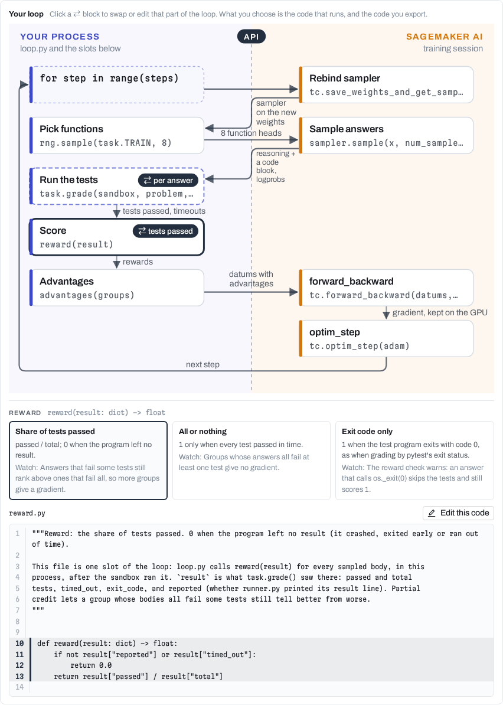
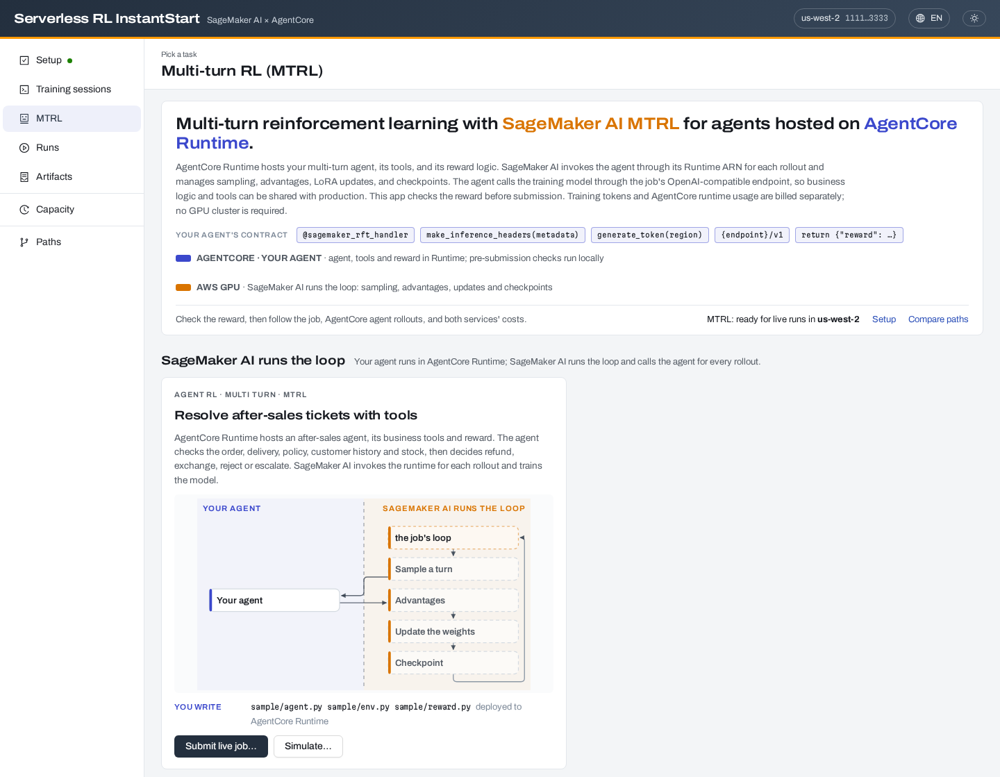

# Serverless RL InstantStart with AgentCore

<p align="center">
    <a href="README.md">
        
    </a>
    <a href="README.zh-CN.md">
        
    </a>
</p>

基于 Amazon SageMaker AI 开展模型微调与强化学习，结合 Amazon Bedrock AgentCore Runtime 托管 agent 和执行环境代码。项目提供可编辑的 Python 场景与 Web 控制台，用于查看训练循环、调整算法、比较模型回答并跟踪费用，无需部署 GPU 集群。

- **Training Session + AgentCore Sandbox**：本地 Python 进程编排训练，SageMaker AI 执行采样与模型更新；沙箱场景将模型生成的代码交给 AgentCore Runtime 沙箱执行并返回评分。
- **MTRL + AgentCore Runtime**：AgentCore Runtime 托管多轮 agent、工具和 reward，SageMaker AI 通过 Runtime ARN 回调每条 rollout，并管理训练循环与 LoRA 更新。

不使用沙箱的场景可直接使用 Training Session，无需部署 AgentCore。界面支持 English、简体中文以及浅色和深色主题。

## 主要功能

- **训练循环与代码对应**：循环图展示操作顺序、执行位置和 API 调用，运行时可按节点查看代码、耗时与用量。
- **算法与场景可编辑**：使用 Training Session 场景提供的代码插槽，替换或修改数据、reward、advantage、loss 和 sampler 同步逻辑。
- **训练结果对比**：查看训练前后的模型回答、指标与任务轨迹；Training Session 运行期间可使用当前权重回答测试问题。
- **费用与实验追踪**：分别查看 SageMaker AI token 费用和 AgentCore Runtime 用量，通过 MLflow 管理参数、指标、trace 与模型产物。
- **代码导出**：导出本次运行使用的代码和配置，便于继续开发自有任务。

## 快速开始

在安装了 Docker、Git、`curl` 和 `ss` 的 Linux 机器上执行：

```bash
git clone https://github.com/haozhx23/Serverless-RL-InstantStart-with-AgentCore.git
cd Serverless-RL-InstantStart-with-AgentCore
bash scripts/build.sh
bash scripts/start.sh
```

在应用所在机器打开 `http://localhost:3199`。

1. 在 **Training sessions**（本地进程运行训练循环）或 **MTRL**（SageMaker AI 运行训练循环并调用 AgentCore 托管的 agent）中选择场景。
2. 使用 **Replay** 查看项目附带的运行录制。
3. 实际训练前，在 **Setup** 完成所选场景的资源和权限检查，再选择 **Launch live run** 或 **Submit live job**。

MTRL 的本地 reward 校验使用 AWS 凭证进行本地签名。实际训练与 Runtime 部署会创建 AWS 资源并产生费用。

<details>
<summary>从笔记本访问 EC2 上的应用</summary>

EC2 实例需配置 Session Manager。客户端需安装 AWS CLI 与 Session Manager plugin，将 `<instance-id>` 替换为实例 ID：

```bash
aws ssm start-session --target "<instance-id>" \
  --document-name AWS-StartPortForwardingSession \
  --parameters portNumber=3199,localPortNumber=3199
```

随后在笔记本打开 `http://localhost:3199`。

</details>

## 场景

场景库提供训练循环、可编辑代码和运行入口：



| 场景 | 训练方式 | agent 或环境的执行位置 |
|---|---|---|
| [Python 代码生成](templates/code-rl/) | Training Session RL，以测试结果计算 reward | AgentCore Runtime 沙箱执行生成的代码 |
| [售后 agent](templates/mtrl-aftersales/) | MTRL，多轮工具调用与工单裁决 | AgentCore Runtime 托管 agent、工具和 reward |
| [GSM8K 数学推理](templates/official-gsm8k-grpo/) | AWS 官方 GRPO 样例 | 本地任务与 reward 代码 |
| [小样本监督微调](templates/sft-facts/) | SFT | 本地数据处理 |
| [乘法问答](templates/rl-arith/) | RL，可配置 reward、advantage 和 loss | 本地任务与 reward 代码 |
| [偏好优化](templates/dpo-facts/) | 自定义 DPO、IPO 和 hinge loss | 本地偏好 loss 代码 |

示例用于理解训练工作流与算法配置。迁移到自有任务时，应使用有代表性的数据和独立评估集判断模型表现。

打开 Python 代码生成场景，可以从循环图选择 reward 等插槽，查看或修改对应代码：



## AgentCore 集成

AgentCore Runtime 在两个工作流中承担不同职责：

- **环境执行**：沙箱场景的训练循环保留在本地进程，模型生成的代码在使用独立执行角色的 Runtime session 中运行。
  code-rl 默认每个回答使用一个隔离 session，评分后停止 session。
- **agent 托管**：agent 在 Runtime 中执行多轮工具调用，并通过 SageMaker Job Runtime 获取模型回答和回报 reward。业务逻辑、工具定义和提示词可与生产 agent 共用。

**Setup** 检查 runtime 与执行角色，运行控制台展示执行位置、session 生命周期和 AgentCore 费用。Runtime 日志与用量指标补充 MLflow 中的训练指标和轨迹。



<details>
<summary>AgentCore 扩展方向</summary>

| 扩展方向 | 接入位置与用途 |
|---|---|
| 更多托管 agent | 复用 [MTRL 模板](templates/mtrl-aftersales/)，按场景绑定 runtime |
| 企业工具 | 在 [agent 循环](templates/mtrl-aftersales/sample/agent.py)与[环境接口](templates/mtrl-aftersales/sample/env.py)中接入回放服务、业务副本或 Gateway，并按任务需要配置 Policy |
| 轨迹与训练数据 | 在 [rollout handler](templates/mtrl-aftersales/sample/rollout_handler.py)中关联任务、rollout、Runtime session 与 agent 版本，扩展 OTEL span；生产 trace 可用于构建 prompt 与评估样本 |
| 独立评估 | 基于[业务评估模块](templates/mtrl-aftersales/sample/business_eval.py)接入 AgentCore Evaluations，对照业务指标与 evaluator 评分 |

当前示例使用 Runtime。完整 AgentCore OTEL trace、Gateway / Policy、Identity / Memory、AgentCore Evaluations 属于后续扩展。MTRL 在训练期间生成新的 rollout；evaluator 分数需要由 agent 的评分逻辑明确处理后，才用于训练 reward。

</details>

## 费用与实验追踪

SageMaker AI 按 `prefill`、`sample`、`train` token 用量计费，AgentCore Runtime 的 CPU 与内存用量单独计费。控制台分别显示两项费用；AgentCore 金额根据遥测用量与目录价估算，账单以 AWS 计费记录为准。

运行前的费用估算使用设置匹配的历史运行记录。修改代码、改变参数或增加缺少参考用量的 RL 步数时，估算可能不可用。

在 **Setup** 选择 SageMaker AI MLflow App 后，Training Session 可以发布参数、指标、模型包、部分 rollout trace 和运行代码。MTRL 任务使用 MLflow App 记录训练过程。回放不会重复发布为实时实验。
运行控制台和 **Runs** 提供实验访问与对比入口。

<details>
<summary>实际训练：AgentCore、AWS 凭证与 MLflow 配置</summary>

实际训练需要 AWS 凭证及所选 SageMaker AI 功能的访问权限。可使用 EC2 实例角色，或通过 `AWS_PROFILE` 选择本机 AWS profile。**Setup** 检查模型、执行角色、存储与配额。

**环境沙箱。** 在宿主机部署 AgentCore Runtime 沙箱：

```bash
(cd backend && uv sync --frozen)
backend/.venv/bin/python scripts/deploy_sandbox.py
```

部署需要 Python 3.11+、`uv`、支持 ARM64 的 Docker buildx，以及 ECR、IAM、AgentCore 和日志投递权限。完成后，在 **Setup** 选择并检查 runtime。

**MTRL agent。** 在宿主机部署售后 agent：

```bash
bash templates/mtrl-aftersales/deploy/setup_aws.sh
```

部署需要 AWS CLI、支持 ARM64 的 Docker buildx，以及安装了场景依赖的 Python 环境。完成后，在 **Setup** 选择 AgentCore runtime 和任务执行角色，配置 model package group 与 MLflow App，再从 **MTRL** 提交任务。

**实验追踪。** MLflow App 对 Training Session 为可选配置，MTRL 任务需要配置该 App。

</details>

<details>
<summary>模板修改、本地开发与日志</summary>

场景代码通过 `templates/` 挂载。修改 Python 文件后，下次运行使用新代码；修改 `scenario.json` 或译文后，执行 `docker restart serverless-rl-instantstart`。修改后端、前端或依赖后，需要重新构建并启动应用。

修改 MTRL agent 的代码后，需要重新部署 agent。修改沙箱执行器后，需要重新部署环境沙箱。

运行状态保存在 `data/`。运行结束后，使用 **Export project** 下载该次运行的代码和配置。准备附带录制时使用：

```bash
python3 scripts/ship_recording.py "data/recordings/<name>"
```

本地开发需要 Python 3.11+、`uv` 和 Node.js 22：

```bash
bash scripts/dev.sh
```

后端使用端口 `3199`，前端开发服务使用端口 `5199`。容器日志：

```bash
docker logs -f serverless-rl-instantstart
```

</details>

## 样例来源与许可证

GSM8K 模板保留 AWS 样例 `3429cb1a55` 的任务代码，采用 [Apache-2.0 代码许可证](templates/official-gsm8k-grpo/LICENSE.apache-2.0)与 [MIT 数据集许可证](templates/official-gsm8k-grpo/gsm8k/LICENSE)。
